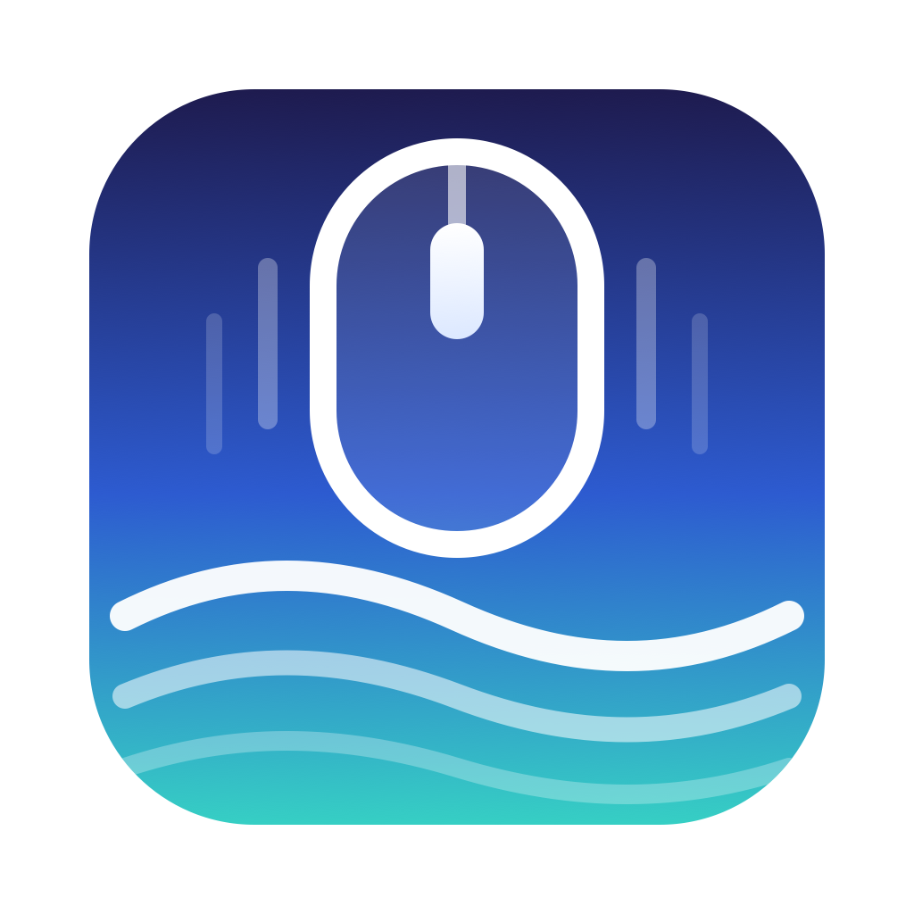

<p align="center"></p>

<h1 align="center">Coast</h1>

<p align="center">Your wheel clicks. The page coasts.</p>

Coast is a tiny macOS menu bar app that makes a regular mouse wheel scroll as smoothly as a trackpad. I built it for my SteelSeries Aerox 5, whose notched wheel jumps the page a line at a time, but it works with any mouse that has a clicky wheel.

It is a stripped-down, English-only take on [Mos](https://github.com/Caldis/Mos) by Caldis. Mos does a lot more. Coast does one thing.

## What it does

- Smooths mouse wheel scrolling everywhere. Each click glides the page instead of jumping it.
- Leaves trackpads, Magic Mouse and free-spinning wheels alone, since they are already smooth.
- Reverses wheel direction (on by default), so the mouse scrolls the classic way while the trackpad keeps natural scrolling.
- Hold Shift to scroll sideways.
- Click anywhere to stop a glide.
- Two sliders in the menu: **Speed** (distance per click) and **Glide** (how long a click takes to settle).
- Open at Login.

That's the whole list. No button remapping, no per-app rules, no updater.

## Install

Requires macOS 14 or later on Apple silicon, and Xcode or the Swift toolchain.

```bash
git clone https://github.com/metaskills/coast.git
cd coast
scripts/build.sh --install
open /Applications/Coast.app
```

On first launch macOS asks for **Accessibility** access. Coast needs it to read and replace wheel events. Turn it on in System Settings → Privacy & Security → Accessibility, and Coast starts working within a couple of seconds.

If you run [Mos](https://github.com/Caldis/Mos), quit it first. Two smoothing apps at once will fight each other.

## How it works

Coast installs one event tap. When a non-continuous wheel event arrives, it swallows it, adds that distance to a target, and lets the page follow the target with a critically damped spring: it eases in, eases out, never overshoots, and lands on the exact distance. The spring is solved in closed form and driven by the display link of the screen under your pointer, so it feels the same on a 60Hz external monitor and a 120Hz ProMotion display. Smoothed events go straight to the app that was under the pointer, so a glide finishes where it started.

All the math lives in `Sources/CoastCore` and is unit tested:

```bash
swift test
```

## Credits and license

Coast is a derivative of [Mos](https://github.com/Caldis/Mos) by [Caldis](https://github.com/Caldis), and keeps its license: [CC BY-NC 4.0](https://creativecommons.org/licenses/by-nc/4.0/). The scroll-event handling follows Mos's approach. The changes: everything except wheel smoothing was removed, the smoothing was rewritten as a frame-rate independent spring, and the UI moved into the menu bar menu. Non-commercial use only. Caldis does not endorse this project.
